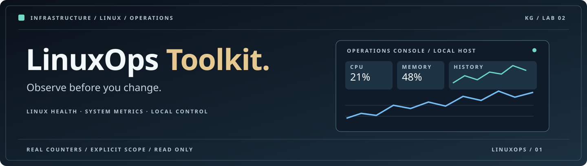

<div align="center">



# LinuxOps Toolkit

**Observe before you change.** A local-first Linux operations lab with near-real-time host telemetry streamed every 2 seconds, a separate SQLite history, a polished browser console, a CLI, alert rules and read-only automation examples.

[Quick start](#quick-start-on-ubuntu--wsl) · [Web console](#web-console) · [CLI](#command-line-interface) · [Architecture](docs/ARCHITECTURE.md) · [Security](docs/SECURITY.md)

</div>

## Why this project exists

LinuxOps demonstrates repeatable operations engineering. It collects overall CPU, memory, disk and network counters from the Linux OS it is running on, stores a local timeline and provides a fast, accessible dashboard. Explicit, simple health thresholds make results explainable. It does not require remote accounts, scan networks, read private files or access anyone else's host.

**Measurement scope matters.** If you run LinuxOps directly inside Ubuntu on WSL 2, it measures the Ubuntu Linux environment, not Windows Task Manager metrics. When run in Docker, measurements can reflect container and cgroup limits and should not be presented as physical host metrics.

## Features

* **Real metrics** via psutil: CPU utilization, logical CPU count, load averages, RAM, swap, root filesystem utilization, aggregate network bytes and packet counters, uptime.
* **Live dashboard** at `http://127.0.0.1:8765`: CPU, RAM, disk and network update about every 2 seconds through a push connection, independently of SQLite history. Overview, compute & memory, storage, network, alerts and architecture sections.
* **Data visualization**: line and area charts, radial memory and disk gauges, utilization bars, detailed network transfer estimates, historical ranges and compact sparklines.
* **Interface controls**: responsive layout, light and dark themes, accessible navigation, refresh pause/resume, user-selected history windows, CSV download, keyboard focus and reduced motion.
* **Efficient history**: SQLite writes approximately once per 30 seconds, with seven-day retention on ingestion. Live memory values do not require a database request.
* **Explicit rules**: warnings at CPU 85%, memory 85% and disk 90%. Critical at 95%. These values are illustrative lab thresholds and should be adapted to a real environment.
* **CLI tools**: snapshot, watch, report, doctor and local web server.
* **Automation examples**: read-only shell preflight and optional Ansible facts for explicitly selected, authorized hosts.
* **API**: `/health`, push stream `/api/v1/live`, `/api/v1/overview`, `/api/v1/history`, `/api/v1/alerts`, `/metrics`, OpenAPI `/docs`.
* **Tests**: unit, CLI and FastAPI integration cases with isolated SQLite storage.

## Quick start on Ubuntu / WSL

For Ubuntu 22.04 or newer on WSL 2, open the **Ubuntu terminal**. Python 3.11+ is required. Python 3.12 is recommended.

**Until this repository is created on GitHub**, download the provided `linuxops-toolkit.zip` archive and extract it into your WSL project folder, for example `~/projects/linuxops-toolkit`.

```bash
cd ~/projects/linuxops-toolkit
python3 -m venv .venv
source .venv/bin/activate
python -m pip install --upgrade pip
python -m pip install -e '.[dev]'
linuxops doctor
linuxops snapshot
linuxops serve
```

On Ubuntu, if `venv` is unavailable, install it with the regular distribution package manager. Do not use `sudo pip install`.

Open in Windows Chrome or Edge: **http://localhost:8765**. Running `linuxops serve` occupies the terminal. Stop with **Ctrl+C**. Access is bound to loopback only, without an external public port.

## Command line interface

```bash
# Human-readable current measurements
linuxops snapshot

# JSON suitable for reviewing or piping into local tools
linuxops snapshot --json

# Store exactly one current sample
linuxops snapshot --save

# Store four real samples, five seconds apart
linuxops watch --interval 5 --count 4

# Export locally collected readings (can redirect to a private file)
linuxops report --format csv > linuxops-report.csv

# Check whether local metrics are readable
linuxops doctor

# Start the live browser console with automatic sampling every 2 seconds
linuxops serve
```

### Live dashboard V2

The first graph view is **Live**, using an SSE stream from the local server. CPU and memory cards, health status and download/upload rate values update when each measurement arrives, usually about every two seconds. The browser keeps at most 120 fine-resolution measurements in memory. Toggle **History** to view the slower, durable 30-second SQLite measurements.

**Important:** A live sample is a measurement taken at that moment. The 2-second schedule is a refresh interval, not an instantaneous or continuous sensor. Native Ubuntu WSL measurements reflect Ubuntu, not the host Windows machine.

To change the sampling cadence, stop the server with Ctrl+C and restart it like this:

```bash
LINUXOPS_LIVE_INTERVAL=1 LINUXOPS_RECORD_INTERVAL=30 linuxops serve
```

The first number sets live updates to 1 second, the second records to SQLite every 30 seconds. Set 2 or 5 seconds instead for less overhead. The collector is shared even if multiple browser tabs are open.

### Optional environment variables

| Variable | Default | Purpose |
| --- | --- | --- |
| `LINUXOPS_DB_PATH` | `~/.local/share/linuxops/telemetry.db` | Private local SQLite file |
| `LINUXOPS_LIVE_INTERVAL` | `2` | Near-real-time sampling interval, 1 to 60 seconds |
| `LINUXOPS_RECORD_INTERVAL` | `30` | Durable SQLite record interval, 5 to 3600 seconds |
| `LINUXOPS_DISK_PATH` | `/` | Existing path to check capacity |
| `LINUXOPS_CONTEXT` | `host` | Data origin label, `host` or `container` |

## Web console

The dashboard uses local HTML/CSS/JavaScript without external scripts, hosted by FastAPI. **Live** charts show recent SSE samples, and **History** charts show durable SQLite snapshots. The top bar distinguishes live, reconnecting, paused and stale states. Clicking a sidebar section changes panels without a browser page reload. `Last 15 min` through `Last 24 hours` apply in History mode. CSV export downloads the samples from the selected chart mode.

Network rate is computed from successive increasing cumulative byte counters. It is not captured by packet inspection, and resetting counters are handled without negative rates. A single sample still displays summary values while timelines fill in.

## Docker demonstration

The Dockerfile and Compose example are optional. **The Docker demo measures the container-visible environment**, so it is not evidence of host monitoring. For a WSL Ubuntu measurement, prefer the native installation above.

```bash
# Ubuntu with Docker Desktop WSL integration enabled
docker compose up --build -d
# http://localhost:8765
docker compose ps
docker compose down
```

The host-side published port is restricted to `127.0.0.1`. Inside the container, Uvicorn binds to all container interfaces solely to accept the local forwarded port. Use `docker compose down -v` only if you intentionally want to delete the demo history volume.

## Read-only automation examples

```bash
bash scripts/linux_preflight.sh
```

If you have Ansible installed, the included inventory targets **localhost** only:

```bash
ansible-playbook -i playbooks/inventory.example.ini playbooks/preflight.yml
```

A future authorized fleet can use a separately approved inventory, SSH identity and access policy. This project does not automatically probe a LAN or install an agent on remote systems.

## Testing

```bash
python -m pytest -q
python -m compileall -q src
python -m linuxops.cli snapshot --json
```

The tests use deterministic fixtures and temporary databases, including SSE replay, bounded subscriptions and network rate calculations. They do not need external equipment or internet connections.

## Repository

```text
linuxops-toolkit/
├── src/linuxops/
│   ├── cli.py              # Commands
│   ├── collector.py        # Current Linux readings
│   ├── rules.py            # Threshold interpretation
│   ├── store.py            # SQLite timeline
│   ├── service.py          # FastAPI local server
│   └── web/                # Responsive dashboard
├── tests/                  # Unit, CLI, and API integration
├── playbooks/              # Explicit read-only Ansible preflight
├── scripts/                # Shell diagnostics
├── docs/                   # System design and security
├── .github/workflows/      # Automated tests
├── Dockerfile              # Container-scoped demonstration
├── docker-compose.yml
└── pyproject.toml
```

## Privacy and security

The dashboard has **no login and is not suitable for remote deployment**. The API is read-only, the collector only sees summary resource counters, and SQLite stays on the local machine. Sample records do not include IP addresses, account names, process lists, SSH keys, environment variables, credentials or file contents. See [SECURITY.md](docs/SECURITY.md) for the complete trust model.

The project is independently authored as a lab and does not contain employer or customer infrastructure information.

## Roadmap

* Filesystem inventory and mounted-volume comparison with explicit permission controls.
* Configurable alert policy and event acknowledgement workflow.
* Opt-in, securely enrolled Linux agent integration with per-device tokens.
* Authorized SSH health checks with known-host verification and explicit inventory.
* Historical anomaly detection using clearly labeled experimental models.

These are planned extensions, **not implemented features**.

## Licensing

No redistribution license has been selected yet. Add a license when publishing a new repository.
